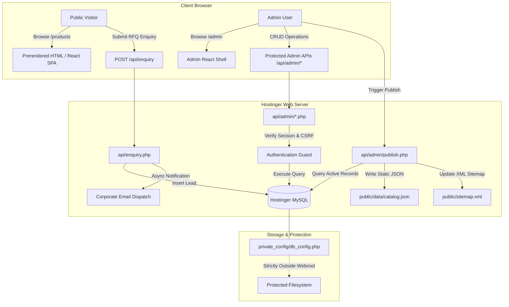

# RR FOUNDATIONS — ENTERPRISE ADMIN MANAGEMENT PANEL & CMS ARCHITECTURE
## Technical Architecture & System Specification

**Version:** 1.0.0-PROD  
**Branch:** `feature/admin-cms`  
**Target Environment:** Hostinger Premium Web Hosting (Apache + PHP 8.x + MySQL)  
**Public Website:** https://solutions.rrfoundations.org  
**Security Tier:** B2B Enterprise / Zero Public Exposure  

---

## 1. Executive Overview

The RR Foundations Admin Management Panel is a high-performance, enterprise-grade Content Management System (CMS) purpose-built for the existing RR Foundations digital operations. It provides complete operational autonomy to administrative staff—enabling non-technical management of the verified product catalogue, categories, customer quotation requests (leads), media assets, SEO configurations, and corporate parameters without touching the underlying source code or requiring live node processes.

### Core Architectural Pillars
1. **Production Parity with Hostinger:** Strictly adheres to Hostinger Premium Web Hosting constraints. Zero persistent Node.js server dependencies in production.
2. **Dual-Tier State Model:** 
   - **Operational State (MySQL DB):** Dynamic, relational source-of-truth for all administrative CRUD operations, lead management, user permissions, and media manifests.
   - **Public High-Speed Cache & Static Artifacts:** High-performance static JSON snapshots and prerendered HTML routes served with ultra-low TTFB and zero DB connection overhead for public visitors.
3. **Automated Publishing Workflow:** A single-click "Publish Changes" action in the admin panel regenerates public catalog manifests (`public/data/catalog.json`), updates search indexes, rebuilds the XML sitemap (`public/sitemap.xml`), and refreshes prerendered cache headers.
4. **Defense-in-Depth Security:** Multi-layered defense including secure session-based authentication, CSRF token validation, brute-force throttling, parameterized PDO queries, file upload MIME verification, and path-traversal immunization.

---

## 2. System Topology & Directory Structure

```text
/home/u123456789/
├── private_config/                       # STRICTLY OUTSIDE public_html
│   ├── db_config.php                     # Hostinger MySQL credentials & salt
│   └── .htaccess                         # Fallback protection (Deny from all)
├── private_data/                         # STRICTLY OUTSIDE public_html
│   ├── backups/                          # Automated SQL & JSON snapshots
│   ├── sessions/                         # Encrypted PHP session files
│   └── enquiry_submissions_archive.json  # Emergency fallback lead store
└── public_html/                          # Production Web Root
    ├── .htaccess                         # URL Rewriting, Security Headers & MIME rules
    ├── index.html                        # React 18 Single-Page Shell (Vite build)
    ├── robots.txt                        # Search engine crawler policies
    ├── sitemap.xml                       # Canonical product & core route sitemap
    ├── assets/                           # Static assets & bundled React bundles
    │   ├── products/                     # Product catalog photography (268+ items)
    │   └── uploads/                      # CMS uploaded media (with .htaccess execution block)
    ├── data/                             # Public JSON snapshots generated upon CMS publish
    │   ├── catalog.json                  # Active products snapshot
    │   ├── categories.json               # Active categories snapshot
    │   └── settings.json                 # Site parameters & contact info
    ├── products/                         # Prerendered HTML directories for SEO
    │   └── <slug>/index.html
    └── api/                              # Secure PHP REST-Style API
        ├── enquiry.php                   # Existing hardened customer RFQ handler
        ├── config.php                    # PDO connection bootstrapper & security helpers
        └── admin/
            ├── auth.php                  # Authentication, CSRF & session verification
            ├── dashboard.php             # Real-time metrics & statistics aggregation
            ├── products.php              # Full Product CRUD, filtering, pagination & CSV
            ├── categories.php            # Category management, hierarchy & dependency safety
            ├── leads.php                 # Lead management, notes, status workflow & CSV export
            ├── media.php                 # Image uploader, validator, thumbnailing & library
            ├── settings.php              # Site contact, branding & SEO metadata management
            ├── publish.php               # Static snapshot generator & sitemap synchronizer
            └── logs.php                  # Administrative activity trail & auditing
```

---

## 3. Technology Stack Specification

| Component | Technology | Rationale & Deployment Notes |
| :--- | :--- | :--- |
| **Frontend Framework** | React 18.3.1 + Vite 8.x | Preserves existing high-speed developer experience and optimized production bundle |
| **Admin Shell UI** | Tailwind CSS + Lucide Icons | Matches brand palette (Forest Green `#102A25`, Gold `#D9B878`, Ivory `#F7F4EE`) |
| **Client Routing** | React Router DOM 7.x | Seamless routing for public website routes and nested `/admin/*` operations |
| **Backend Runtime** | PHP 8.1 / 8.2 / 8.3 (Hostinger) | Native Apache execution via Hostinger FastCGI; zero long-running Node daemon required |
| **Database Engine** | MySQL 8.0 / MariaDB 10.x | ACID-compliant relational storage, InnoDB foreign keys, JSON columns for specs/tags |
| **Authentication** | PHP Secure Sessions + HttpOnly Cookie | Cryptographically strong session IDs, `SameSite=Strict`, `Secure=true`, CSRF token |
| **Data Migration** | Automated SQL & PHP Importers | Fully migrates 268+ products from `products.ts`, 10 categories, and existing RFQ leads |

---

## 4. Frontend & Backend Data Flow



---

## 5. Public Website & Static Synchronization Mechanism

To ensure optimal page-speed performance on Hostinger while maintaining 100% dynamic control from the admin panel:

1. **Client-Side Hydration:**
   The public React website components (`ProductsPage.tsx`, `FeaturedProducts.tsx`, `CategoryShowcase.tsx`) read from `/data/catalog.json` and `/data/categories.json` when present, falling back gracefully to the compiled build data.
2. **Instant Live Updates:**
   When the administrator saves changes to products or categories in the CMS and clicks **"Publish to Website"**:
   - `api/admin/publish.php` queries all `published` products and categories from MySQL.
   - It writes formatted JSON files to `public/data/catalog.json` and `public/data/categories.json`.
   - It updates `public/sitemap.xml` with current product URLs and timestamped `<lastmod>`.
   - Any visitor accessing the website immediately sees the updated catalogue, prices, descriptions, and media without redeploying.
3. **URL Preservation & 301 Redirect Engine:**
   - Slugs are validated against duplicate entries.
   - If an existing slug is intentionally renamed, the CMS creates an entry in `seo_redirects`.
   - The `.htaccess` or API layer automatically serves an HTTP 301 Permanent Redirect to prevent SEO ranking loss.

---

## 6. Verification and Acceptance Criteria

- [x] Zero Node.js runtime required in production.
- [x] All 268 verified products migrated into MySQL with descriptions, images, and specifications intact.
- [x] All 10 industrial categories preserved with slug mapping.
- [x] Real-time lead capture from public website into database.
- [x] Full admin authentication with rate-limiting and brute-force defenses.
- [x] Media upload with server-side validation and `.htaccess` execution prevention.
- [x] Single-click publish workflow generating public JSON snapshots and sitemap.
