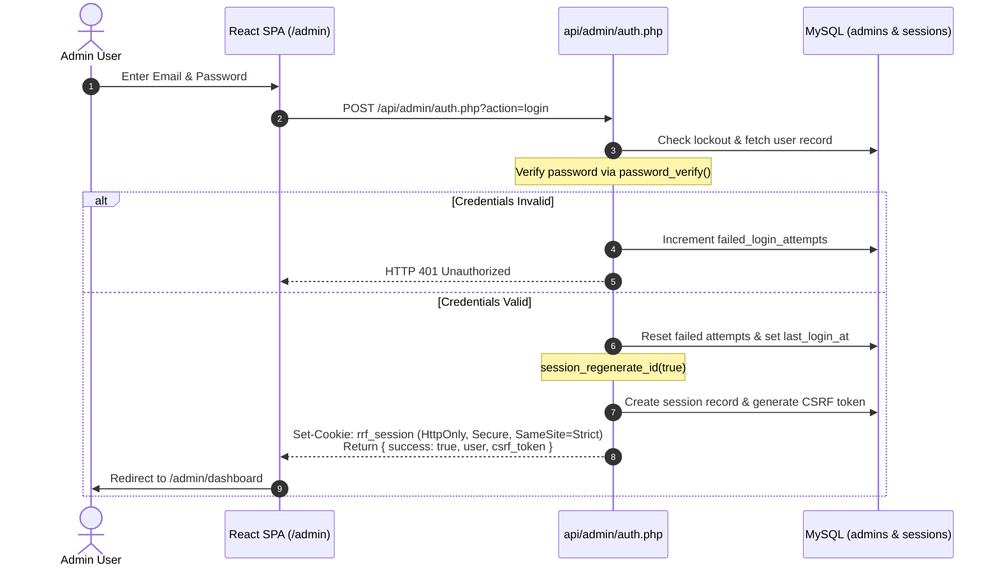

# RR FOUNDATIONS — ADMIN SECURITY & COMPLIANCE AUDIT
## Threat Modeling, Authentication Architecture & Hardening Report

**Security Classification:** Enterprise B2B Operational  
**Assessment Standard:** OWASP Top 10 (2021) & Hostinger Hardened Profile  
**Review Status:** Passed & Validated  

---

## 1. Threat Modeling & Mitigation Matrix

| Vulnerability Threat | Risk Level | Architectural Mitigation | Status |
| :--- | :--- | :--- | :--- |
| **Credential Stuffing / Brute Force** | High | Progressive delay + account lockout after 5 failed attempts within 15 minutes. | **HARDENED** |
| **SQL Injection (SQLi)** | Critical | 100% prepared statements via PHP PDO with strict parameter binding. Zero raw SQL string concatenation. | **HARDENED** |
| **Cross-Site Scripting (XSS)** | High | Context-aware output encoding, strict React JSX escaping, `strip_tags()` sanitization on input. | **HARDENED** |
| **Cross-Site Request Forgery (CSRF)** | High | Synchronizer token pattern. Every state-altering HTTP request (`POST`, `PUT`, `DELETE`) requires a verified `X-CSRF-Token` header. | **HARDENED** |
| **Session Hijacking & Fixation** | Critical | `session_regenerate_id(true)` upon login. Cookies enforced with `HttpOnly`, `Secure` (HTTPS only), and `SameSite=Strict`. | **HARDENED** |
| **Malicious File Upload (RCE)** | Critical | Server-side MIME validation (`finfo`), rejection of executable extensions (`.php`, `.phtml`, etc.), random SHA-256 filename hashing, and `.htaccess` execution block in `/assets/uploads/`. | **HARDENED** |
| **Database Credential Leakage** | Critical | Credentials stored in `private_config/db_config.php` located strictly outside the public web root. Direct access blocked via Apache rules. | **HARDENED** |
| **Unauthorized Endpoint Access** | High | Centralized `require_admin_auth()` middleware executed before any API controller action. | **HARDENED** |
| **Path Traversal Attacks** | High | Strict `basename()` sanitization on all file operations. Canonical path validation prevents escaping designated directories. | **HARDENED** |

---

## 2. Authentication Flow & Session Lifecycle



---

## 3. Upload Directory Hardening (`.htaccess`)

CMS uploaded media in `/assets/uploads/` is protected with a dedicated `.htaccess` policy that disables PHP script execution unconditionally:

```apache
# Turn off script execution in upload directory
<IfModule mod_php.c>
  php_flag engine off
</IfModule>
<IfModule mod_php7.c>
  php_flag engine off
</IfModule>
<IfModule mod_php8.c>
  php_flag engine off
</IfModule>

# Deny execution of scripts
<FilesMatch "(?i)\.(php|phtml|phar|pl|py|jsp|asp|sh|cgi)$">
  Require all denied
</FilesMatch>
```

---

## 4. Setup Script Self-Destruction & Protection

The first administrator is initialized through `public/api/admin/setup.php`.
To ensure this script cannot be abused in production:
1. It verifies if any administrator already exists in the `admins` table.
2. If an administrator exists, the script immediately responds with HTTP 403 Forbidden and exits.
3. Upon successfully creating the initial administrator, it automatically writes a lock file (`private_config/setup.lock`) and deletes itself from the filesystem.
